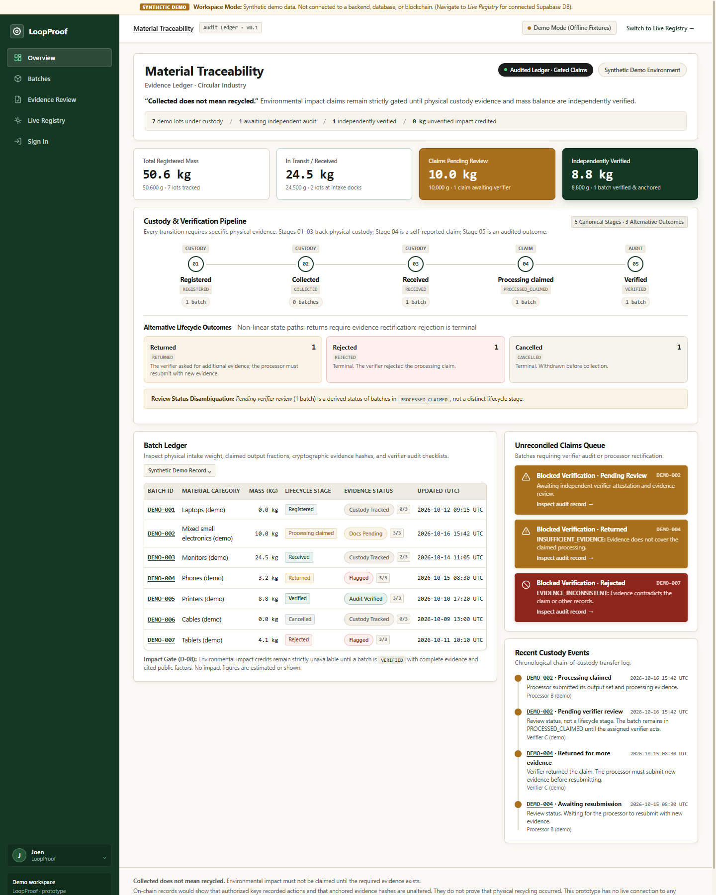
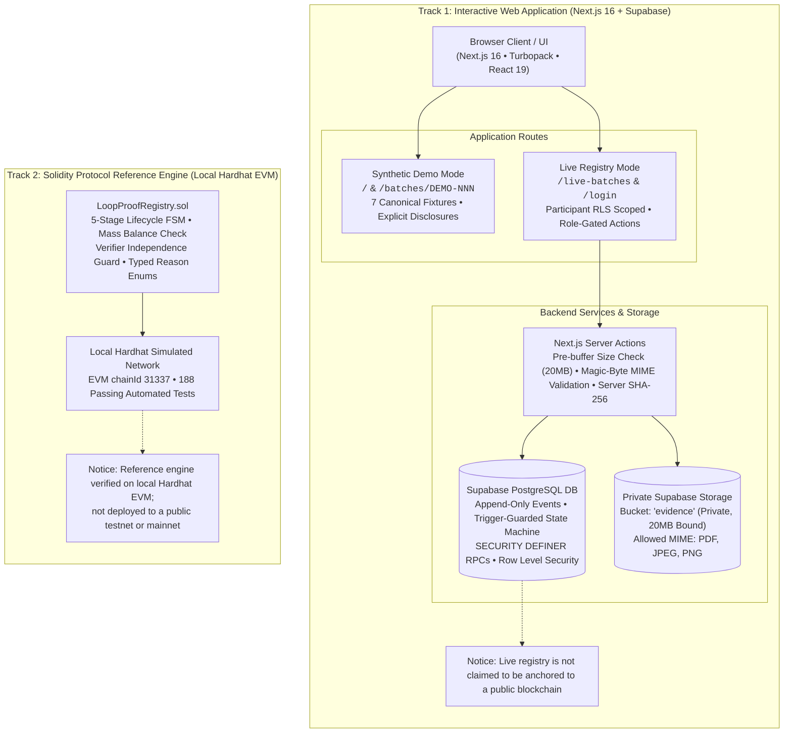

# LoopProof

**Evidence-gated e-waste traceability for sustainable supply chains.** Built for the IEEE ClimateChain Global Hackathon 2026 — Sustainable Supply Chains track.

[](https://github.com/vishu2212/LoopProof/actions/workflows/ci.yml) [](#license)

> **Collected does not mean recycled. Environmental impact must not be claimed until the required evidence exists.**

LoopProof models an e-waste batch through explicit custody and review stages, separates processing claims from independently verified outcomes, and keeps evidence hashes distinct from the evidence files themselves.

- **Live web app:** https://loop-proof.vercel.app/
- **Source repository:** https://github.com/vishu2212/LoopProof
- **Track:** Sustainable Supply Chains

### Explore the demo

- [Open the dashboard](https://loop-proof.vercel.app/)
- [Pending verifier review — DEMO-002](https://loop-proof.vercel.app/batches/DEMO-002)
- [Returned for insufficient evidence — DEMO-004](https://loop-proof.vercel.app/batches/DEMO-004)
- [Verified, impact unavailable — DEMO-005](https://loop-proof.vercel.app/batches/DEMO-005)

> The dashboard and `DEMO-*` records are synthetic fixtures for demonstration. They are not evidence of real-world collection, recycling, or environmental impact. The live Supabase registry is a separate workflow and requires an authorized account.



---

## The Problem

E-waste collection, facility receipt, processing claims, and verified processing are often collapsed into a single sustainability claim. That makes it difficult for downstream buyers, auditors, and the public to distinguish a recorded handoff from a substantiated environmental outcome.

---

## What LoopProof Does

- Records batch registration and assigned collector, processor, and independent verifier roles.
- Models an explicit finite state machine: `REGISTERED → COLLECTED → RECEIVED → PROCESSED_CLAIMED → VERIFIED`.
- Supports structured alternative outcomes (`RETURNED`, `REJECTED`, `CANCELLED`); these are not canonical lifecycle stages.
- Stores evidence metadata and SHA-256 digests while keeping uploaded evidence files in private storage.
- Enforces role- and state-aware actions through Supabase Auth, PostgreSQL functions, and Row Level Security.
- Checks processing mass totals against intake ($Output \le Intake$). A balanced claim cannot be returned with `MASS_DISCREPANCY`.
- Gates environmental impact display: no numerical impact estimate is shown before `VERIFIED`; verification alone is not enough without complete evidence and cited public factors.
- Keeps the human responsible for confirming the e-waste category; AI assistance is advisory, not proof.

---

## Application Walkthrough & Key Verification Flows

The web application provides an interactive, evidence-gated ledger illustrating core governance rules across canonical lifecycle stages:

| Screen / Flow | Evidence & Governance State | Key Principles Demonstrated |
| :--- | :--- | :--- |
| **Material Traceability Dashboard**<br>`/` | Multi-batch pipeline across all lifecycle stages | Full pipeline visibility from collection to verification. Highlights mass conservation, review queue, and active custody. |
| **Independent Verifier Review**<br>`/batches/DEMO-002` | `PROCESSED_CLAIMED` → Verifier Review | [5-criterion audit checklist](docs/screenshots/demo-002-pending-review.png), distinct evidence digests, custody timeline, and mass-balance checks ($Output \le Intake$). |
| **Alternative Outcome: Returned**<br>`/batches/DEMO-004` | Alternative outcome: `RETURNED` | [Typed return reason](docs/screenshots/demo-004-returned.png) (`INSUFFICIENT_EVIDENCE`), remediation guidance, and unverified status disclosure. |
| **Verified & Impact Gated**<br>`/batches/DEMO-005` | Canonical stage: `VERIFIED` | [Independent acceptance](docs/screenshots/demo-005-verified.png). Environmental impact remains strictly **Unavailable** because avoided burden is never claimed without complete evidence and cited public factors. |

> All four screenshots are available in high resolution within the [`docs/screenshots/`](docs/screenshots/) directory:
> - [`docs/screenshots/dashboard.png`](docs/screenshots/dashboard.png) — Operational custody dashboard
> - [`docs/screenshots/demo-002-pending-review.png`](docs/screenshots/demo-002-pending-review.png) — Batch pending verifier review with 5-criterion checklist
> - [`docs/screenshots/demo-004-returned.png`](docs/screenshots/demo-004-returned.png) — Batch returned for insufficient evidence
> - [`docs/screenshots/demo-005-verified.png`](docs/screenshots/demo-005-verified.png) — Verified batch with gated (unavailable) environmental impact

---

## Architecture Overview

LoopProof implements a **dual-track architecture**:



1. **Interactive Web Application (`web/`):**
   - **Offline Demo Mode (`/`, `/batches/[batchId]`):** Interactive walkthrough across 7 canonical demo batches (`DEMO-001` through `DEMO-007`) illustrating every lifecycle transition, verifier checklists, alternative outcomes (`RETURNED`, `REJECTED`, `CANCELLED`), and strict impact gating.
   - **Live Cloud Registry (`/login`, `/live-batches`, `/live-batches/[batchId]`):** Interactive live registry powered by Supabase Auth and PostgreSQL with Row Level Security (`auth.uid()`), trigger-guarded state transitions, append-only audit logs, and `SECURITY DEFINER` RPCs (`lp_register_batch`, `lp_record_collection`, `lp_record_receipt`, `lp_submit_processing`, `lp_verify_batch`, `lp_return_batch`, `lp_reject_batch`, `lp_cancel_batch`).
2. **Solidity Smart Contract Reference Engine (`contracts/`):**
   - `LoopProofRegistry.sol` implements the 5-stage finite state machine (`REGISTERED` → `COLLECTED` → `RECEIVED` → `PROCESSED_CLAIMED` → `VERIFIED`) with immutable participant locking, strict conservation of mass ($Output \le Intake$), verifier conflict-of-interest prevention, and typed return/reject reason codes.
   - Tested and verified locally on Hardhat EVM (`chainId 31337`) across 188 automated test cases.

---

## Repository Layout

```
contracts/   Solidity sources (LoopProofRegistry.sol, LoopProofTypes.sol)
test/        Hardhat contract test suites (188 passing Mocha/Chai specs)
docs/        DECISIONS.md, STATE_MACHINE.md, CONTRACT_TEST_PLAN.md, submission brief
supabase/    PostgreSQL schema migrations, RLS policies, triggers, and RPC procedures
web/         Next.js 16 web application (Turbopack, TypeScript, React 19)
```

---

## Demo and Implementation Status

The project contains a Next.js web app, a Supabase-backed live workflow, and Solidity contracts with a local test suite.

**The live Supabase workflow and the Solidity contracts are separate parts of this prototype. The Solidity contracts have been tested locally; do not assume they are deployed to a public testnet.** The live web workflow currently records lifecycle actions in Supabase. A database record or evidence hash proves what the system recorded, not that physical collection or recycling actually occurred.

The demo dashboard and its seven sample batches are synthetic. The live registry uses the configured Supabase project. Synthetic test records used during development are not evidence of real-world recycling or environmental impact.

---

## Quick Start & Verification

Requires Node.js 22+ (developed on Node 24).

### 1. Smart Contract Verification (Root Package)

```bash
# Install root dependencies reproducibly from package-lock.json
npm ci

# Compile contracts
npm run build      # hardhat build

# Run complete 188-test contract suite
npm test           # hardhat test

# Run contract TypeScript checks
npm run typecheck  # hardhat build && tsc --noEmit
```

### 2. Web Application & Schema Verification (`web/`)

```bash
cd web

# Configure environment variables (template provided)
cp .env.local.example .env.local

# Install web dependencies reproducibly from web/package-lock.json
npm ci

# Run web & database schema invariant suite
npm test

# Run TypeScript type check
npm run typecheck

# Run Next.js production build
npm run build

# Start local development server
npm run dev        # http://localhost:3000
```

---

## Environment Variables

### Web Application (`web/.env.local.example`)
```bash
NEXT_PUBLIC_SUPABASE_URL=https://tvsjrxjvmebbofjdzxnm.supabase.co
NEXT_PUBLIC_SUPABASE_PUBLISHABLE_KEY=<your-supabase-publishable-or-anon-key>
```
*Security: Only the public URL and publishable (anon) key belong in `.env.local`. Row Level Security (RLS) enforces access control based on `auth.uid()`. Service role keys are never exposed.*

### Testnet Deployment (Optional — `.env.example`)
```bash
# Primary testnet: Base Sepolia (see docs/DECISIONS.md D-02)
BASE_SEPOLIA_RPC_URL=<your-base-sepolia-rpc-url>
BASE_SEPOLIA_PRIVATE_KEY=<testnet-only-private-key-never-real-funds>

# Fallback testnet: Polygon Amoy (only if Base Sepolia fails verification)
POLYGON_AMOY_RPC_URL=<your-polygon-amoy-rpc-url>
POLYGON_AMOY_PRIVATE_KEY=<testnet-only-private-key-never-real-funds>
```

---

## Core Principles & Guarantees

1. **Collected Does Not Mean Recycled:** Physical pickup and facility intake are intermediate custody stages. They do not constitute recycling proof.
2. **Gated Impact Claims:** Numerical environmental impact metrics remain completely unavailable and are never credited until independent verification is confirmed.
3. **Verifier Independence:** The assigned verifier must be distinct from both the collector and the processor. Self-verification reverts immediately.
4. **Conservation of Mass:** Claimed output materials must not exceed recorded intake mass ($TotalOutputs \le IntakeMass$).
5. **Typed Audit Reasons:** Verifier returns and rejections require explicit enum reason codes (`INSUFFICIENT_EVIDENCE`, `MASS_DISCREPANCY`, `EVIDENCE_INCONSISTENT`, etc.) enforced by the reference smart contract and database check constraints. Free-text reasons are rejected.
6. **Zero PII in Public Registries:** Off-chain evidence files stay in private storage. Only SHA-256 hashes and minimal lifecycle metadata are recorded.

---

## Smart Contract & Blockchain Deployment Status

- **Status:** Verified locally on Hardhat simulated network (EVM `chainId 31337`, 188 passing unit and adversarial tests).
- **Public Testnet:** Currently not deployed to a public testnet. Hardhat configuration supports Base Sepolia (primary) and Polygon Amoy (fallback) via lazy `configVariable()` bindings.
- **Scope of Protocol Claims:** Contract and ledger records demonstrate that authorized cryptographic keys recorded custody handoffs and that recorded evidence hashes have not been altered since submission. They do not prove that physical recycling occurred without valid off-chain evidence audits.

---

## Trust, Privacy, and Limitations

- A hash establishes integrity relative to the hashed file; it does not establish the truth of the file's contents.
- A recorded event establishes that an authorized account submitted an action; it does not independently prove physical custody or processing.
- Keep personal information and raw evidence off public ledgers. The evidence bucket is intended to remain private.
- Environmental impact must remain unavailable until the batch is verified, required evidence is complete, and cited public impact factors are available. Any gross avoided-burden estimate must be presented with its factors and assumptions, not as a carbon credit or guaranteed net impact.
- The prototype uses role-based accounts and a centralized Supabase backend. It is not a fully decentralized production deployment and has not been independently security-audited.

---

## Hackathon Alignment

**Sustainable Supply Chains:** LoopProof focuses on e-waste lifecycle traceability, evidence-backed processing claims, independent review, and transparent limits on environmental-impact reporting. The goal is to make it harder to confuse collection with verified processing and to make unsupported claims visible rather than silently treating them as impact.

---

## License

This repository currently has **no open-source license** (`UNLICENSED` in `package.json`). All rights remain reserved by the copyright holder. Do not assume permission to copy, modify, redistribute, or use this code commercially. Add a `LICENSE` file only after the project owner chooses a license.
