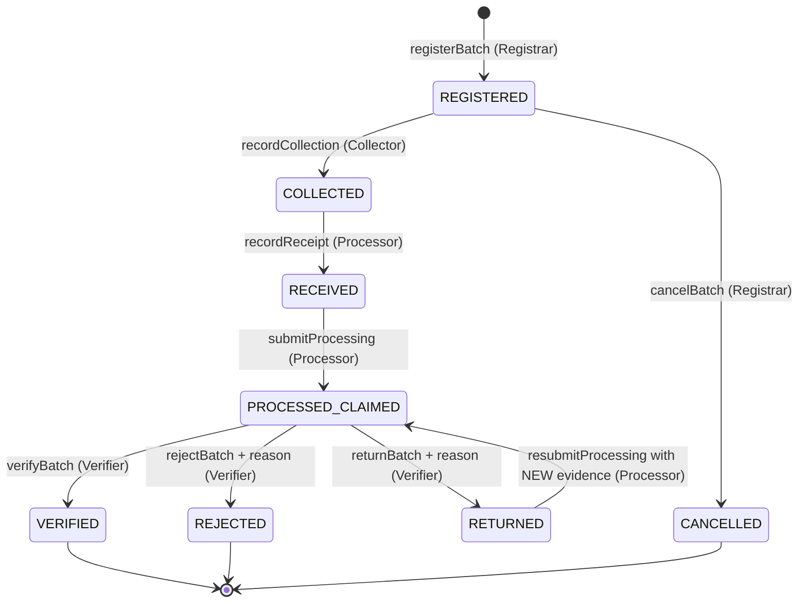

# LoopProof — Batch Lifecycle State Machine (Specification)

> *Collected does not mean recycled.* Each state records **what has been claimed or attested, and by whom** — never more.

Status: **implemented in `contracts/LoopProofRegistry.sol` (Milestone 1, local only — not deployed).** Shared enums/structs live in `contracts/LoopProofTypes.sol`. The lifecycle below is unchanged from Milestone 0; Milestone 1 only resolved the open questions (see §6 and DECISIONS D-12 – D-17).

## 1. States

| # | State | Meaning | Who moves it here | Terminal? |
|---|-------|---------|-------------------|-----------|
| 0 | `NONE` | Batch ID does not exist (Solidity default). | — | — |
| 1 | `REGISTERED` | Batch created with a unique claim key, a registrar-attested (human-confirmed) category, and assigned collector, processor, and verifier. Nothing collected yet. | Registrar | No |
| 2 | `COLLECTED` | Collector attests it physically collected the batch, with recorded intake mass and an evidence hash. | Assigned collector | No |
| 3 | `RECEIVED` | Processor attests receipt of the batch at its facility, with an evidence hash. | Assigned processor | No |
| 4 | `PROCESSED_CLAIMED` | Processor **claims** processing, recording output masses and an evidence hash. This is a claim, not proof. | Assigned processor | No |
| 5 | `VERIFIED` | The assigned independent verifier has reviewed the evidence and accepts the processing claim. | Assigned verifier | **Yes** |
| 6 | `RETURNED` | Verifier requests additional evidence (with a reason code). Processor must submit new evidence before resubmitting. | Assigned verifier | No |
| 7 | `REJECTED` | Verifier rejects the claim (with a reason code). | Assigned verifier | **Yes** |
| 8 | `CANCELLED` | Batch withdrawn before collection. | Assigned registrar (D-16/D-17: admin and other registrars cannot cancel) | **Yes** |

## 2. Transition diagram

## 3. Transition table (exhaustive)

Any (from, action) pair not listed here **must revert**.

| From | Action (contract function) | To | Required actor | Required data |
|------|----------------------------|----|----------------|---------------|
| `NONE` | register (`registerBatch`) | `REGISTERED` | `REGISTRAR_ROLE` | unique non-zero claim key, non-zero category code, collector/processor/verifier addresses holding their roles, verifier ≠ collector and ≠ processor |
| `REGISTERED` | collect (`recordCollection`) | `COLLECTED` | assigned collector + `COLLECTOR_ROLE` | intake mass > 0 (grams), new evidence hash |
| `REGISTERED` | cancel (`cancelBatch`) | `CANCELLED` | assigned registrar + `REGISTRAR_ROLE` | — |
| `COLLECTED` | receive (`recordReceipt`) | `RECEIVED` | assigned processor + `PROCESSOR_ROLE` | new evidence hash |
| `RECEIVED` | claimProcessed (`submitProcessing`) | `PROCESSED_CLAIMED` | assigned processor + `PROCESSOR_ROLE` | 1–16 outputs (non-zero material code, mass > 0), total ≤ intake, new evidence hash |
| `PROCESSED_CLAIMED` | verify (`verifyBatch`) | `VERIFIED` | assigned verifier + `VERIFIER_ROLE` | — |
| `PROCESSED_CLAIMED` | return (`returnBatch`) | `RETURNED` | assigned verifier + `VERIFIER_ROLE` | return reason code (§4a) |
| `PROCESSED_CLAIMED` | reject (`rejectBatch`) | `REJECTED` | assigned verifier + `VERIFIER_ROLE` | reject reason code (§4a) |
| `RETURNED` | resubmit (`resubmitProcessing`) | `PROCESSED_CLAIMED` | assigned processor + `PROCESSOR_ROLE` | complete replacement output set (same rules), **new** evidence hash |

## 4. Rules

1. **No skipped stages or arbitrary regression.** Only the transitions in §3 are valid. The sole backward edge is `PROCESSED_CLAIMED → RETURNED → PROCESSED_CLAIMED`, and it requires new evidence.
2. **Role authorization.** Only an address holding the required role may perform its permitted action. Holding a role does not grant other roles' actions. Lifecycle actions on an existing batch (including `cancelBatch`) require both holding the role at call time and being the address **assigned** to that batch (`registrar`, `collector`, `processor`, or `verifier`; D-17). `DEFAULT_ADMIN_ROLE` manages role membership only and has no lifecycle authority (D-16).
3. **Verifier independence.** The verifier must differ from both the batch's collector and its processor. Enforced at registration and re-checked as defense-in-depth at verify/return/reject. Self-verification by either must revert.
4. **Uniqueness.**
   - A duplicate **claim key** must be rejected — including keys of cancelled, verified, or rejected batches (claim keys are never reusable).
   - A previously used **evidence hash** must be rejected anywhere in the system (same batch or a different batch, any stage). Resubmission after `RETURNED` therefore requires genuinely new evidence.
   - The zero hash (`bytes32(0)`) is never valid evidence; the zero claim key is never valid.
5. **MVP mass-balance rule.** The sum of recorded processing output masses must not exceed the recorded intake mass for that batch. Units are integers in grams (`uint128` per value; summed in `uint256`, so no overflow is possible within the 16-output limit).
6. **Terminal immutability.** `VERIFIED`, `REJECTED`, and `CANCELLED` accept no further transitions or data changes.
7. **Cancellation window.** `CANCELLED` is reachable only from `REGISTERED` (before collection), and only by the registrar that registered the batch.
8. **Impact gating.** Impact estimates are unavailable until `VERIFIED`. The contract stores no impact numbers; off-chain systems must not display numeric estimates for unverified batches.
9. **Privacy.** No raw serial numbers, personal data, claim-key secrets, or evidence files on-chain (D-05). The claim key is an opaque `bytes32` commitment computed off-chain (e.g., a salted hash); the salt and underlying identifiers stay off-chain. The contract has no `string`/`bytes` inputs.
10. **Events.** Every successful transition emits `BatchStateChanged(batchId, from, to, actor, evidenceHash)` plus a detail event, so the history is reconstructable off-chain. `evidenceHash` is the hash submitted (collect/receive/submit/resubmit), the hash of the revision under review (verify/return/reject), or zero (register/cancel).
11. **Processor (and all assignees) locked at registration** (D-15). There is no function to change an assignee.
12. **Revisions** (D-13). Each submit/resubmit appends a revision (evidence hash, total output mass, timestamp, outputs). Resubmission replaces the *current* output set; earlier revisions remain queryable, and a returned revision records its return reason.

### 4a. Reason codes (D-14)

`0 = NONE` is never accepted. Values outside the enum range revert during ABI decoding.

| Return reason (`ReturnReason`) | Code | Meaning |
|---|---|---|
| `INSUFFICIENT_EVIDENCE` | 1 | Evidence does not cover the claimed processing. |
| `EVIDENCE_UNREADABLE` | 2 | Evidence cannot be opened, read, or matched to its hash. |
| `OUTPUT_DATA_INCOMPLETE` | 3 | Output set is missing fractions or material codes. |
| `MASS_DISCREPANCY` | 4 | Output masses need explanation relative to intake. |

| Reject reason (`RejectReason`) | Code | Meaning |
|---|---|---|
| `EVIDENCE_INCONSISTENT` | 1 | Evidence contradicts the claim or other records. |
| `MASS_BALANCE_IMPLAUSIBLE` | 2 | Reported outputs are not credible for the intake. |
| `PROCESSOR_NOT_QUALIFIED` | 3 | Processor facility is not authorized for this material. |
| `CHAIN_OF_CUSTODY_BROKEN` | 4 | Custody between collection and receipt cannot be established. |

Category codes (`uint16`) and output material codes (`uint16`) are opaque non-zero integers whose meanings are defined off-chain (to be documented in a later milestone).

## 5. What the blockchain does — and does not — prove

| Demonstrates | Does **not** demonstrate |
|--------------|--------------------------|
| An authorized key recorded a given action at a given block/time. | That the physical action actually occurred. |
| Evidence matching an anchored hash has not been altered since anchoring. | That the evidence is truthful or complete. |
| The recorded sequence obeyed the lifecycle rules. | That material was genuinely recycled. |
| The verifying key differs from the collector/processor keys. | That the organizations behind those keys are truly independent (an off-chain governance question). |

If backend-managed (custodial) keys are used in the demo, signatures show only that the backend acted under that role — not that the organization personally signed (DECISIONS D-10).

## 6. Resolved questions (Milestone 1)

- Registration: dedicated `REGISTRAR_ROLE` (D-12).
- Resubmission: replaces the current output set; history preserved (D-13).
- Reason codes: explicit lists in §4a (D-14).
- Processor: locked at **registration** (D-15; supersedes the earlier "fixed at receive" proposal).

### Known limitations (not changed in M1)

- Intake mass is recorded once, by the collector. The processor's receipt does not record a separate received mass, so mass-balance is checked against the collector-reported intake.
- Because `registrar`, `collector`, `processor`, and `verifier` are locked per batch at registration (D-15, D-17), an admin cannot advance, verify, return, reject, or cancel any existing batch registered by another account — even if the admin grants itself lifecycle roles. However, `DEFAULT_ADMIN_ROLE` can revoke roles (blocking pending actions on existing batches) or grant roles to colluding accounts to register and walk through *new* batches, so admin key custody remains a governance trust assumption.
